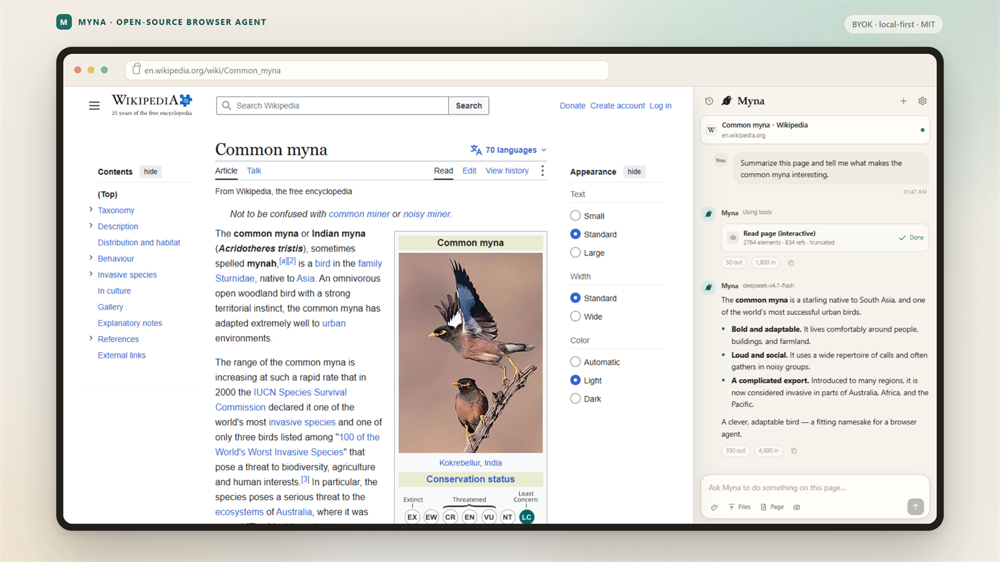
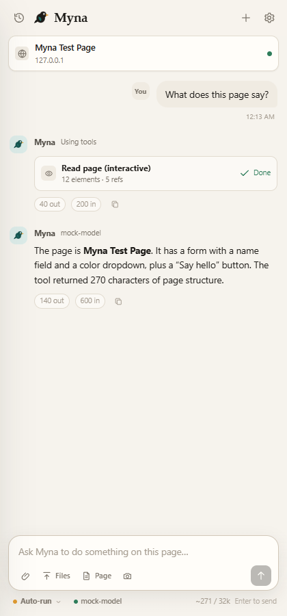
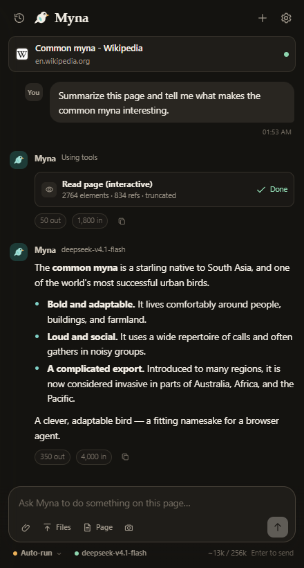
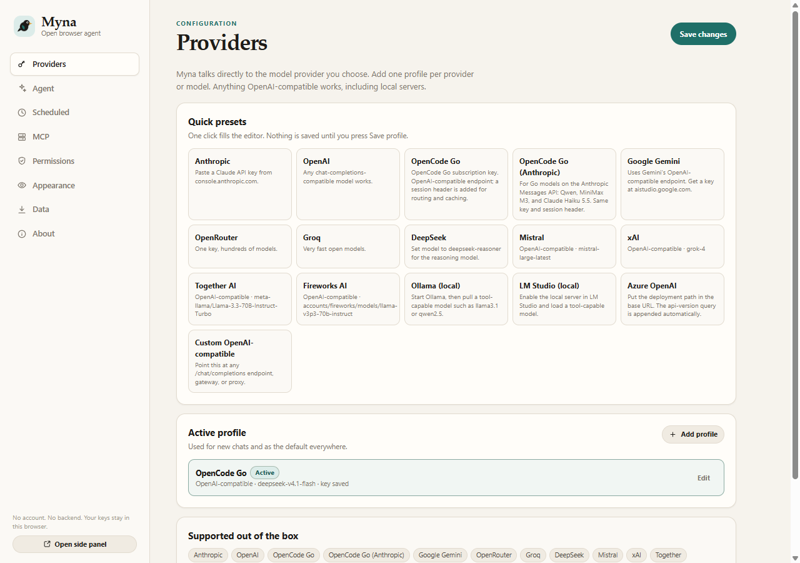
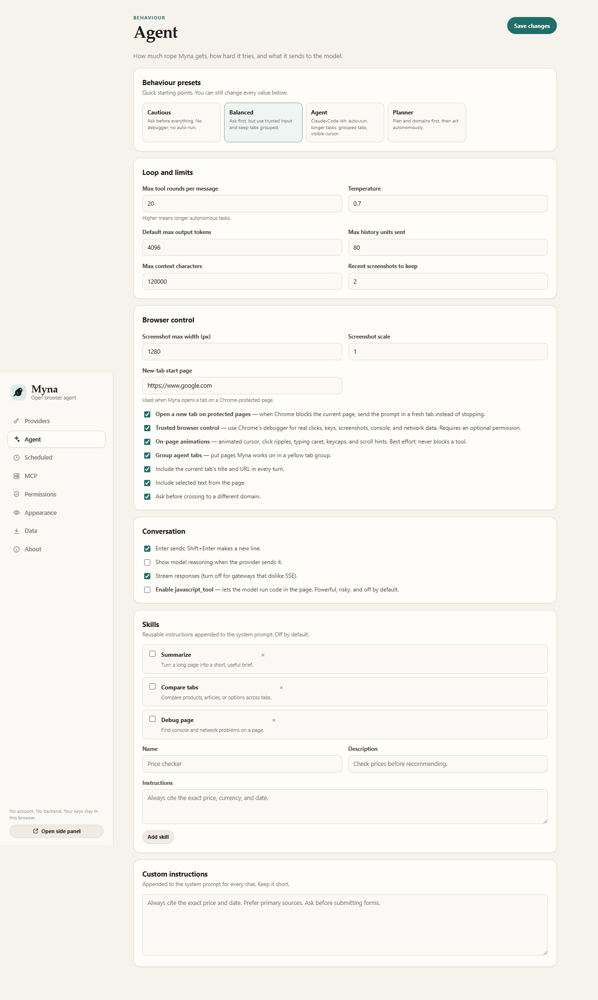
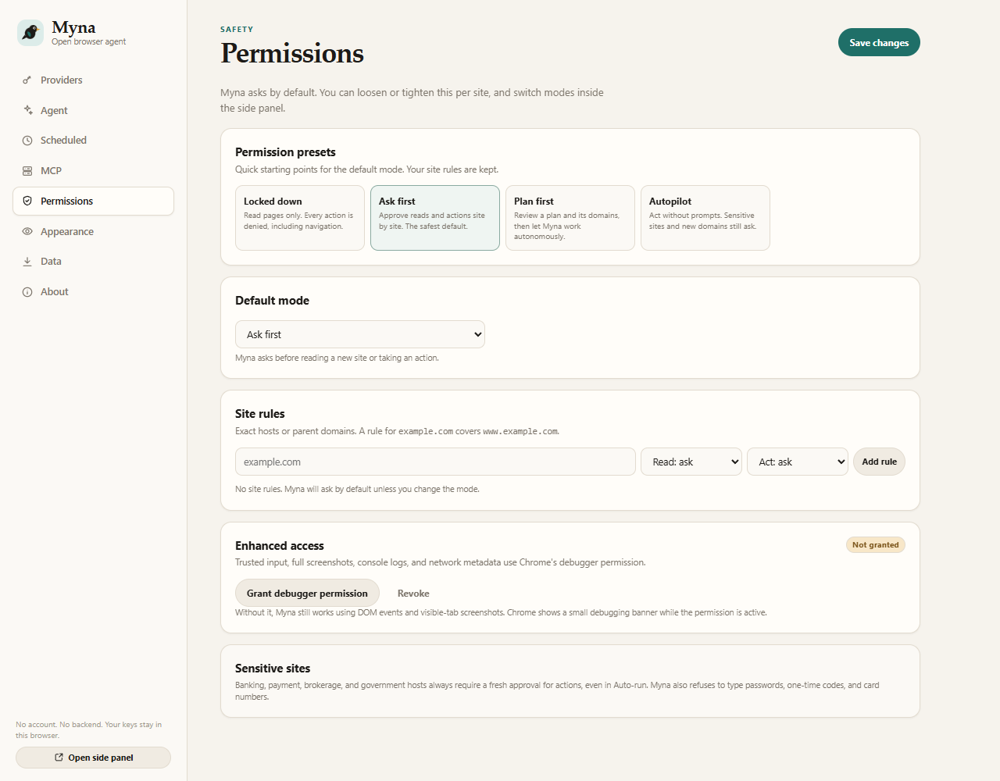
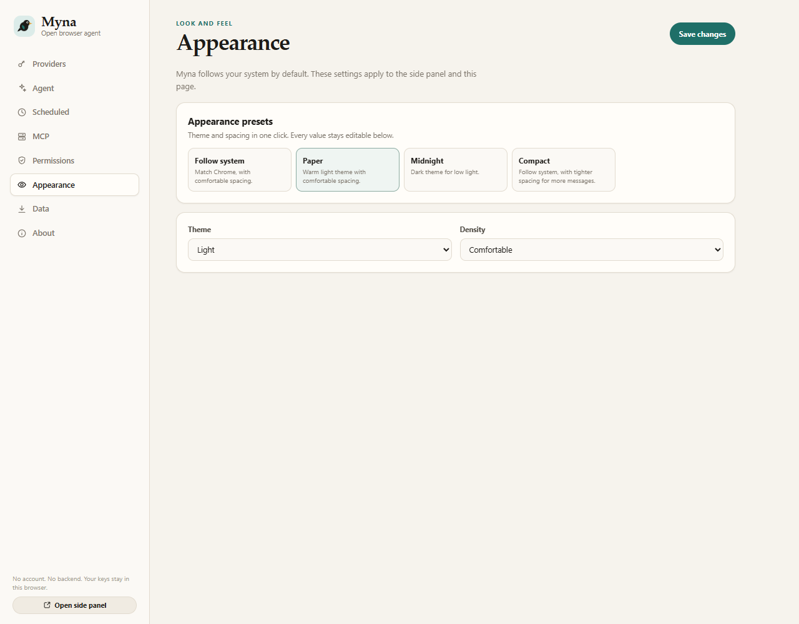
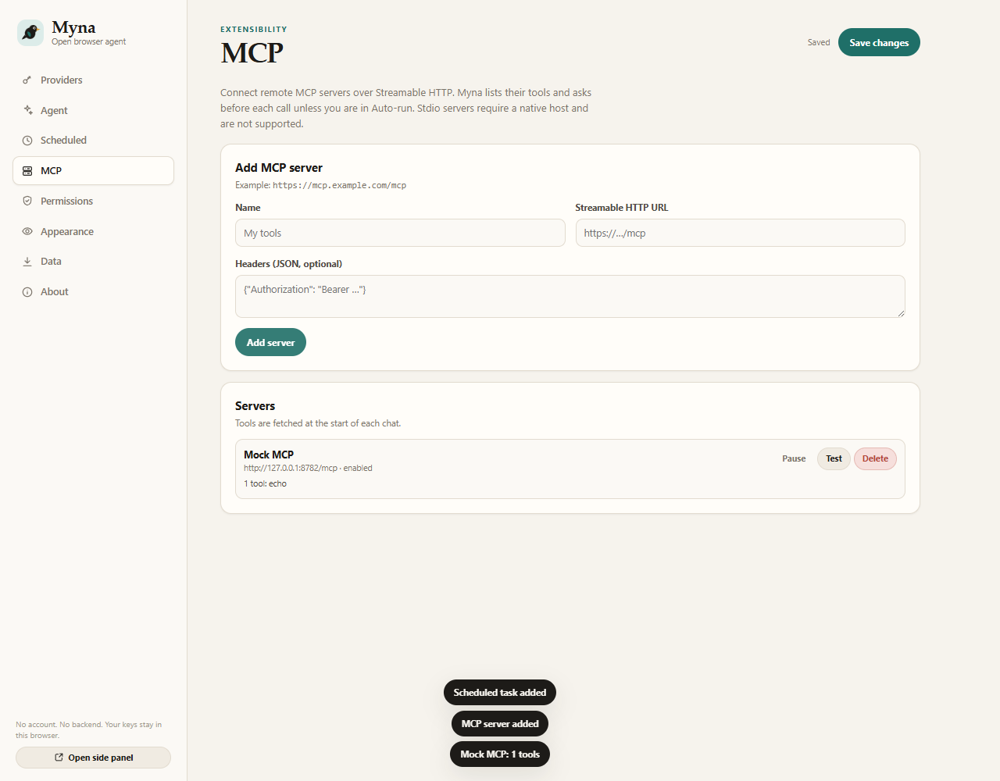
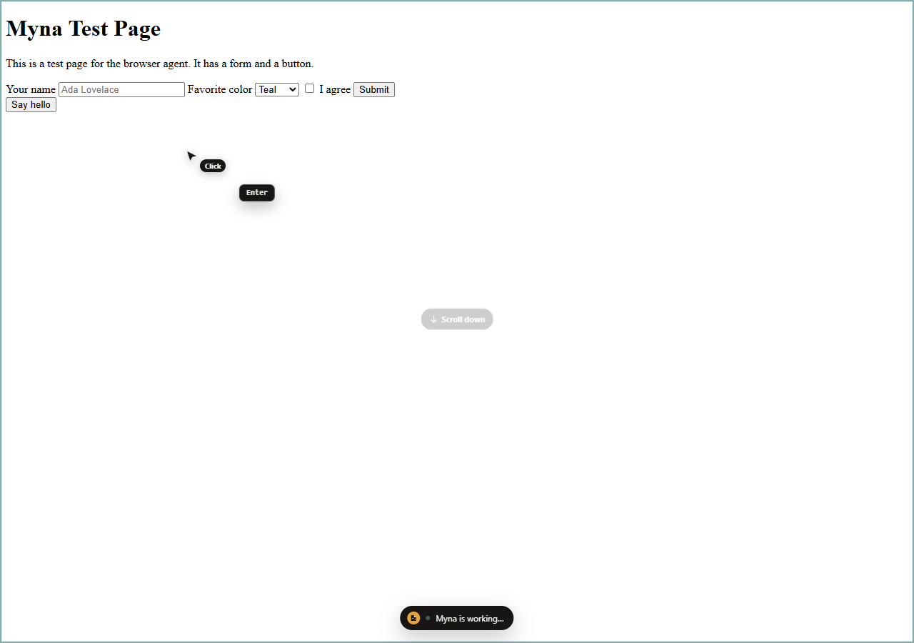

<p align="center">
  
</p>

<h1 align="center">Myna</h1>

<p align="center">
  <strong>The open-source alternative to Claude in Chrome.</strong><br />
  Bring your own model. Let an AI agent read, click, fill, and research across your tabs.<br />
  No Myna account. No backend. No telemetry.
</p>

<p align="center">
  <a href="https://github.com/DumDuky/myna-browser-agent/releases/latest"></a>
  <a href="https://github.com/DumDuky/myna-browser-agent/actions/workflows/ci.yml"></a>
  
  <a href="LICENSE"></a>
  
  <a href="CONTRIBUTING.md"></a>
</p>

<p align="center">
  <a href="https://github.com/DumDuky/myna-browser-agent/releases/latest"><strong>Download</strong></a>
  ·
  <a href="#install">Install</a>
  ·
  <a href="#what-myna-can-do">Features</a>
  ·
  <a href="#screenshots">Screenshots</a>
  ·
  <a href="#providers">Providers</a>
  ·
  <a href="#faq">FAQ</a>
  ·
  <a href="docs/limitations.md">Limitations</a>
</p>



Myna puts an AI browser agent in Chrome's side panel. It uses the model provider you choose, talks to that provider directly, and stores your chats in Chrome. You can run it with Anthropic, OpenAI, OpenCode Go, Gemini, a local Ollama model, or any OpenAI-compatible gateway.

Myna is an independent, clean-room project. It is not affiliated with or endorsed by Anthropic. Claude in Chrome is a product of Anthropic.

> **Beta:** the core agent works and has tests, but interfaces and model presets can change. Read [limitations](docs/limitations.md) before you trust it with anything irreversible.

## Start here

- **New to Myna?** [Download the latest release](https://github.com/DumDuky/myna-browser-agent/releases/latest), then follow [Install](#install).
- **Want to read the code?** The extension runs directly from source. There is no build step and no bundled runtime.
- **Want to contribute?** Read [CONTRIBUTING.md](CONTRIBUTING.md). Provider presets, docs, tests, and accessibility fixes are all useful.
- **Need help?** See [SUPPORT.md](SUPPORT.md) or open a [discussion](https://github.com/DumDuky/myna-browser-agent/discussions).

## Why Myna

- **Use the model you already pay for.** Myna works with hosted APIs and local models. You control the provider, model, key, and spending limit.
- **Keep the conversation in one place.** One chat follows the active tab. Switch tabs and Myna updates the page context without starting over.
- **Approve what matters.** Choose Ask first, Auto-run, Plan first, or Read only. Add site rules. Sensitive sites still ask in Auto-run.
- **Audit the whole extension.** Every line is plain HTML, CSS, or ES modules. No minified bundle, no remote script, no hidden service.
- **Extend it without a vendor roadmap.** Add remote MCP tools, reusable skills, scheduled runs, or a custom OpenAI-compatible gateway.
- **Keep your data local.** Chats, settings, rules, and keys live in Chrome storage. Myna runs no server and collects no analytics.

### How Myna is different

| | Myna | A typical hosted browser assistant |
| --- | --- | --- |
| Account | Not required | Usually required |
| Model | Any provider you configure | Selected by the vendor |
| Data path | Browser to your provider | Through the vendor service |
| Source code | MIT, readable | Closed |
| Chat history | Local Chrome storage | Usually account-based |
| Extensibility | MCP, custom gateways, skills | Vendor roadmap |

This table describes hosted browser assistants in general. Check each product's current terms before comparing details.

## What Myna can do

| Area | What you get |
| --- | --- |
| **Reading** | Accessibility tree with stable element refs, fuzzy find, readable page text, console logs, network metadata |
| **Acting** | Click, type, press keys, scroll, hover, drag, fill forms, upload files, take screenshots |
| **Tabs** | List tabs in every window, create, close, group, navigate, resize |
| **Research** | Direct URL fetch, Bing RSS search, multi-tab comparison, page summaries |
| **Workflow** | Plans, permission cards, tool progress, skills, scheduled tasks, GIF export |
| **Models** | Anthropic Messages, OpenAI Chat Completions, 16 presets, local servers, custom gateways |
| **Safety** | Sensitive-site checks, domain prompts, password and card-field refusal, prompt-injection guidance |
| **Privacy** | Local history, session-only keys, no telemetry, no Myna account |

## Screenshots

### One chat across your tabs

| Light | Dark |
| --- | --- |
|  |  |

### Pick a provider and model



### Tune the agent, permissions, and theme

| Agent presets | Permission presets | Appearance presets |
| --- | --- | --- |
|  |  |  |

### Add remote MCP tools



## Install

### From a release

1. Open the [latest release](https://github.com/DumDuky/myna-browser-agent/releases/latest).
2. Download `myna-browser-agent-0.2.0.zip` and extract it.
3. Open `chrome://extensions`.
4. Turn on **Developer mode**.
5. Click **Load unpacked** and select the extracted `myna-browser-agent-0.2.0` folder.
6. Pin Myna to the toolbar.

### From source

```bash
git clone https://github.com/DumDuky/myna-browser-agent.git
cd myna-browser-agent
```

Load the repository folder unpacked in `chrome://extensions`. There is no build step.

Chrome, Edge, Brave, and other Chromium browsers with the Side Panel API work. Chrome 116 or newer is required. Myna cannot read `chrome://`, the Chrome Web Store, the PDF viewer, or other protected pages. With **Open a new tab on protected pages** enabled, it can open a normal tab and work there instead.

## Connect a model

Open Settings, pick a provider preset, paste a key, and press **Save & start**.

| Provider | API shape | Example base URL | Notes |
| --- | --- | --- | --- |
| Anthropic | Messages | `https://api.anthropic.com` | Key from `console.anthropic.com` |
| OpenAI | Chat Completions | `https://api.openai.com/v1` | Any current chat model |
| OpenCode Go | OpenAI-compatible | `https://opencode.ai/inference/go/openai/v1` | Subscription key; DeepSeek, Kimi, GLM, MiMo, MiniMax 3.1 Flash |
| OpenCode Go (Anthropic) | Messages | `https://opencode.ai/inference/go/anthropic` | Subscription key; Qwen, MiniMax M3, Claude Haiku 5.5 |
| Google Gemini | OpenAI-compatible | `https://generativelanguage.googleapis.com/v1beta/openai` | Key from AI Studio |
| OpenRouter | OpenAI-compatible | `https://openrouter.ai/api/v1` | One key, many models |
| Groq | OpenAI-compatible | `https://api.groq.com/openai/v1` | Fast open models |
| DeepSeek | OpenAI-compatible | `https://api.deepseek.com` | `deepseek-chat` or `deepseek-reasoner` |
| Mistral | OpenAI-compatible | `https://api.mistral.ai/v1` | |
| xAI | OpenAI-compatible | `https://api.x.ai/v1` | |
| Together | OpenAI-compatible | `https://api.together.xyz/v1` | |
| Fireworks | OpenAI-compatible | `https://api.fireworks.ai/inference/v1` | |
| Azure OpenAI | OpenAI-compatible | `https://RESOURCE.openai.azure.com/openai/deployments/DEPLOYMENT` | Add `api-version=...` in the query field |
| Ollama | OpenAI-compatible | `http://localhost:11434/v1` | No key; pull a tool-capable model |
| LM Studio | OpenAI-compatible | `http://localhost:1234/v1` | No key; enable the local server |
| Custom | OpenAI-compatible | anything | Gateways, proxies, self-hosted |

The model needs **tool calling** for browser actions. Text-only models can chat and summarize, but they cannot click or type. Model IDs move fast, so every field is editable. See [docs/providers.md](docs/providers.md) for wire-format details.

### OpenCode Go

The **OpenCode Go** preset uses the OpenAI-compatible endpoint and defaults to `deepseek-v4.1-flash`. A second **OpenCode Go (Anthropic)** preset covers Qwen, MiniMax M3, and Claude Haiku 5.5 on the Messages endpoint. Both send a per-conversation `x-opencode-session` header for routing and cache affinity. Models served through OpenAI's Responses API or Google's native API need a matching adapter and are not suggested by the presets.

## Using Myna

Type a request in the side panel. Myna sees the active tab, can list every tab in the browser, and can act once you grant permission. One chat is global to the browser. Switching tabs moves the page context, not the conversation. Click the context bar to re-sync it with the active tab.

Try:

- "Summarize this page and list the decisions I need to make."
- "Find the pricing table and compare the middle two plans."
- "Fill in this form with the details below, but don't submit it."
- "Open the docs in a new tab and find the authentication section."
- "Read the console and tell me why the save button fails."
- "Compare the top three results and make a recommendation."

### Modes

| Mode | What it means |
| --- | --- |
| **Ask first** | Prompts before reading a new site or taking an action. |
| **Auto-run** | Acts without prompts on approved sites. Sensitive sites and new domains still ask. |
| **Plan first** | Proposes a plan and domains. You approve, then it works autonomously on those domains. |
| **Read only** | Inspects pages but cannot click, type, navigate, fill forms, or change tabs. |

### Protected pages

Chrome blocks extensions on `chrome://`, the Web Store, the PDF viewer, and similar pages. On one of those, the side panel offers **Open a normal tab**. With **Open a new tab on protected pages** enabled in Settings, sending a prompt does it automatically. Myna opens your configured start page, attaches to it, and runs the request there. The protected page itself is never read.

### MCP servers

Settings, then MCP, connects remote **Streamable HTTP** MCP servers. Add a name, URL, and optional headers. Myna calls `tools/list` at the start of each chat and exposes tools as `mcp__<server>__<tool>`. Stdio servers, legacy HTTP+SSE, OAuth, and a resources/prompts UI are not supported.

### Scheduled tasks

Settings, then Scheduled, adds daily or weekly runs. Chrome must be running. Each run opens a visible Myna window, uses Auto-run, records the result, and sends a notification. Sensitive-site prompts are denied because no side panel is open.

### Presets and motion

Settings, then Providers has provider presets and a common-model picker. Settings, then Agent has **Cautious**, **Balanced**, **Agent**, and **Planner**. Settings, then Permissions has **Locked down**, **Ask first**, **Plan first**, and **Autopilot**, and applying a preset leaves per-site rules untouched. Settings, then Appearance has **Follow system**, **Paper**, **Midnight**, and **Compact**.

The on-page overlay draws a moving cursor with labels, click ripples, a typing caret, keycaps, scroll hints, and an element flash. It is cosmetic, can be disabled, respects `prefers-reduced-motion`, and hides before screenshots.



### Keys and privacy

- Keys live in `chrome.storage.local` by default.
- A profile can use **session-only keys** in `chrome.storage.session`, which disappear when Chrome closes.
- Keys go only to the provider base URL you configure.
- Myna has no telemetry, no relay, and no account system.
- See [PRIVACY.md](PRIVACY.md) and [SECURITY.md](SECURITY.md).

### Safety

- Myna refuses to type passwords, one-time codes, or payment-card fields.
- Banking, brokerage, payment, and government hosts always prompt for actions, even in Auto-run.
- Page content is untrusted data. The system prompt tells the model to ignore prompt injection inside pages.
- Confirm purchases, messages, deletions, account changes, and form submissions yourself.
- CAPTCHAs, login walls, paywalls, and age gates are stop signs. Myna does not bypass them.

## Tool reference

<details>
<summary><strong>Open the tool list</strong></summary>

| Tool | Purpose |
| --- | --- |
| `read_page` | Accessibility tree with stable `ref_N` element IDs |
| `find` | Local fuzzy search over page elements, returns refs |
| `get_page_text` | Readable article and main text extraction |
| `computer` | Click, type, key, scroll, hover, drag, screenshot, zoom, wait |
| `form_input` | Set text, select, checkbox, radio, date, range, contenteditable |
| `file_upload` | Attach user-picked files to a page file input |
| `web_fetch` | Fetch an http(s) URL as readable text |
| `web_search` | Lightweight Bing RSS search |
| `gif_creator` | Record and export browser actions as a GIF |
| `navigate` | URL, back, forward |
| `tabs_context` | List tabs, IDs, groups, and windows |
| `tabs_create` / `tabs_close` | Open or close tabs, grouped when enabled |
| `read_console_messages` | Console and uncaught errors (debugger) |
| `read_network_requests` | HTTP request metadata (debugger) |
| `resize_window` | Responsive testing |
| `browser_batch` | Up to 12 tool calls in one round trip |
| `update_plan` | Plan approval and progress |
| `javascript_tool` | Off by default; page-context JavaScript |

</details>

See [docs/tools.md](docs/tools.md) for inputs and behaviour. Remote MCP tools are added dynamically as `mcp__<server>__<tool>`.

## How it works

```text
side panel ── provider API (your key, direct)
    │
    ├── agent loop (stream → tool calls → tool results → stream)
    │
    └── service worker
          ├── tab groups + tab lifecycle
          ├── page agent (injected, isolated world)
          │     ├── accessibility tree + refs
          │     ├── DOM form/click/type actions
          │     └── on-page indicator
          └── optional CDP bridge
                ├── trusted mouse/keyboard input
                ├── screenshots
                └── console/network capture
```

- No build step. The extension loads directly from source.
- The side panel owns the conversation and calls your provider directly.
- The service worker is the only place with privileged browser APIs.
- Page tools run in Chrome's isolated world through `chrome.scripting`.
- The side panel is global. Per-tab panel documents and chats are not used.
- Content never reaches a Myna server because there is no Myna server.

More detail: [docs/architecture.md](docs/architecture.md).

## FAQ

**Do I need an Anthropic account?**  
No. Myna supports Anthropic, OpenAI, OpenCode Go, Gemini, OpenRouter, Groq, DeepSeek, Mistral, xAI, Together, Fireworks, Azure, Ollama, LM Studio, and any OpenAI-compatible endpoint.

**Which model should I use?**  
Pick a model with tool calling and a context window that fits the pages you work with. Frontier models handle messy pages best. Local models work well for simple reading and form tasks.

**Is Myna free?**  
Myna is MIT licensed and costs nothing. You pay your model provider directly. Local models cost nothing beyond your hardware.

**Does it work in Edge or Brave?**  
It works in Chromium browsers with the Side Panel API, including Chrome 116 or newer, Edge, and Brave. Chrome is the tested target.

**Can Myna read `chrome://` pages?**  
No. Chrome blocks every extension there. Myna can open a normal tab and work there instead.

**Where does my data go?**  
Chats, settings, rules, and keys stay in Chrome storage. Page content goes to the model provider you configure. MCP tool calls go to the MCP server you add. Myna runs no backend.

**Why is this beta?**  
The browser tools and provider adapters are tested, but model APIs, sites, and Chrome APIs change. The project ships fixes from the issues users report.

## Development

Requirements: Node 20 or newer for tests and static checks. There are no npm dependencies.

```bash
npm test        # unit tests for SSE, providers, permissions, settings, scheduler
npm run check   # parse every script and validate manifest references
npm run verify  # run both
```

Load the repository folder unpacked in `chrome://extensions` after changes.

### Project layout

```text
.
├── manifest.json
├── src/
│   ├── background/      service worker, tabs, CDP, scheduler, tool executor
│   ├── lib/             providers, prompts, permissions, markdown, settings, MCP
│   ├── page/            injected page agent (tree, refs, actions)
│   ├── sidepanel/       chat UI and agent loop
│   ├── options/         provider, agent, permission, MCP, and data settings
│   ├── runner/          visible scheduled-task window
│   └── assets/          original Myna icon
├── tests/               Node test runner
├── docs/                architecture, tools, providers, limitations, releases
├── scripts/check.mjs    syntax and manifest validation
└── .github/             CI, release workflow, issue and PR templates
```

## Limitations

The full list is in [docs/limitations.md](docs/limitations.md). Highlights:

- Chrome 116 or newer. GitHub releases ship a zip, not a Chrome Web Store package, and there is no auto-update.
- Remote MCP only: Streamable HTTP. No stdio servers, legacy HTTP+SSE, OAuth, resources/prompts UI, or sampling.
- No Claude Desktop pairing, native messaging, relayed inference, or Claude Code integration.
- Scheduled tasks need Chrome running and open a visible window. There is no cloud cron, and sensitive-site prompts are denied.
- File uploads use a synthetic `DataTransfer`. Sites that require a real picker may ignore them.
- GIF recording caps at 40 frames and 640 px wide, and frames live in service-worker memory.
- Web search uses Bing RSS, not a licensed search API.
- No memory, projects, or multi-agent orchestration.
- No cross-origin iframe or closed-shadow-root control.
- No PDF viewer control, `file://` access, Chrome Web Store access, or browser-internal pages.
- No CAPTCHA, login-wall, paywall, or anti-bot bypass.
- Text-only models cannot use screenshots. Tool calling is required for actions.
- Without the optional debugger, synthetic events can fail, and drag, console, and network are unavailable.
- Sensitive-site detection and prompt-injection defenses are best effort. They are not guarantees.

Myna is not a pixel copy of Claude in Chrome or Claude Code. It does not use their source code.

## Contributing

Issues and pull requests are welcome. Good first contributions include provider presets, documentation fixes, test coverage, accessibility, and small UI polish.

- Read [CONTRIBUTING.md](CONTRIBUTING.md).
- Follow the [Code of Conduct](CODE_OF_CONDUCT.md).
- Report vulnerabilities privately through [SECURITY.md](SECURITY.md).
- Use [SUPPORT.md](SUPPORT.md) for questions.
- Check the [open issues](https://github.com/DumDuky/myna-browser-agent/issues) before starting.

If Myna saves you time, a star helps other people find it.

## Reverse-engineering note

[docs/reverse-engineering.md](docs/reverse-engineering.md) documents the architectural study of the original extension that informed this project. No proprietary source, assets, fonts, or copy were reused. Myna is an independent implementation with its own UI, prompts, code, and icon.

## Licence

MIT. See [LICENSE](LICENSE). Bundled third-party notices are in [THIRD_PARTY_NOTICES.md](THIRD_PARTY_NOTICES.md).

Myna is not affiliated with Anthropic, Google, OpenAI, or any provider named in this repository. Provider names are trademarks of their respective owners.
